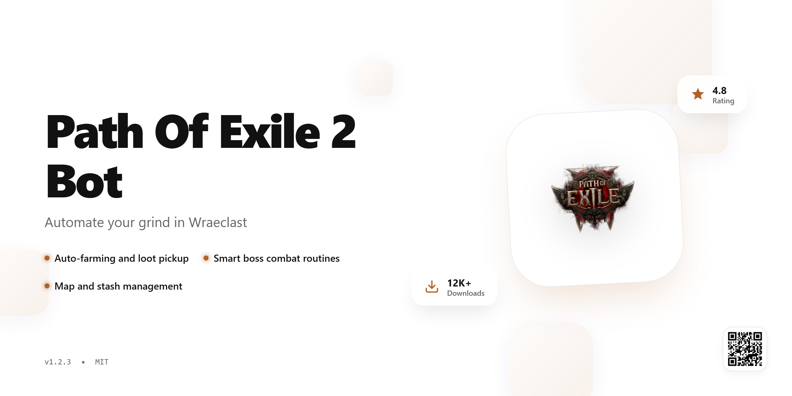

# 🌟 Path Of Exile 2 Companion: Automation, Multi-Account & Proxy Support for Discord & Telegram

### 🛠️ PowerShell Setup Button

    

---

Path Of Exile 2 Bot is a community-built companion for Windows that takes the grind out of Wraeclast, bundling captcha handling, proxy support, and multi-account management into one friendly package. Whether you're juggling several characters or just want the repetitive parts handled quietly in the background, the bot adapts to how you play. It's openly available to everyone, shaped by feedback from the folks who use it daily, and updated regularly to keep pace with the game. Jump into the community, share your ideas, and help make it even better.

## ✅ Requirements

- Windows 10 or Windows 11
- PowerShell 5.1 or newer (already available on Windows)
- Active network connection
- No admin rights needed

## ✨ Features

**🖥️ Windows Native** – Built from the ground up for Windows, so it feels right at home on your machine with zero fuss.
- **🔁 Multi-Account Hub** – Juggle as many game accounts as you like from one tidy panel — add, label, and swap between them in a click.
- **🌐 Proxy Friendly** – Route each account through its own connection for cleaner separation and better privacy while you play.
- **🛡️ Captcha Handling** – Encounter a verification wall? The bot walks you through it smoothly so your session keeps rolling instead of stalling.
- **⚡ Task Automation** – Hand off the repetitive stuff — resource runs, routine movement, timed actions — and get your time back for the fun parts.
- **🎛️ Simple Configuration** – A clean, approachable interface with sensible defaults. Tweak what you care about, ignore what you don't.
- **🔄 Steady Updates** – We track game patches and refresh the bot regularly, so you're never left behind after a new build drops.
- **💙 Community First** – Shaped by feedback from the people who actually use it. Ideas, bug reports, and feature requests all get a real look.
- **🧩 Zero Clutter** – No bloat, no background noise. Lightweight, portable, and easy to pick up whether you're a first-timer or a seasoned tinkerer.

## 🤖 Commands

Welcome to the command center! 🎮 This is where the Path Of Exile 2 Bot really comes alive. Whether you're chatting through Discord, sending quick requests over Telegram, or just poking around to see what's possible, these commands are your friendly toolkit for getting things done fast. Everything is designed to feel natural — type it, send it, and the bot takes care of the rest. No menus to memorize, no complicated syntax to wrestle with.

Below you'll find the main command groups, organized by what they help you accomplish. Each one is built with the community in mind, so feel free to experiment. If a command needs a parameter, you'll see it clearly noted. And if you ever get stuck, just ask the bot for help — it's always happy to lend a hand. 💬

### 🧭 Core & Session Commands

These are the everyday commands that keep your bot session running smoothly.

- **`/start`** — Wake the bot up and open a fresh session. Great for first-time visitors.
- **`/help`** — Pull up a friendly overview of everything the bot can do, grouped by category.
- **`/ping`** — Quick health check. Confirms the bot is awake and responsive.
- **`/status`** — See the current state of your session: active tasks, connected accounts, and proxy mode.
- **`/stop`** — Gracefully pause any running automation and return to idle.
- **`/resume`** — Pick up right where you left off after a `/stop`.

### 👥 Account Management Commands

Juggling several characters or profiles? These commands keep everything tidy and organized.

- **`/account add <label>`** — Register a new profile under a friendly name you choose.
- **`/account list`** — See every profile you've set up, along with its current status.
- **`/account switch <label>`** — Flip between profiles instantly — no logging out and back in.
- **`/account remove <label>`** — Cleanly detach a profile you no longer need.
- **`/account rename <old> <new>`** — Give a profile a clearer name whenever you like.
- **`/account limits`** — Review the soft caps and cooldowns tied to each profile.

### 🌐 Proxy & Connection Commands

Route your traffic the way you want and keep connections steady.

- **`/proxy add <address> <port>`** — Attach a proxy endpoint to your current setup.
- **`/proxy list`** — View every endpoint you've registered, with live reachability.
- **`/proxy test <address>`** — Run a quick connectivity check before committing.
- **`/proxy rotate`** — Cycle through your registered endpoints on a schedule or on demand.
- **`/proxy remove <address>`** — Drop an endpoint from the pool.
- **`/proxy mode <auto|manual>`** — Choose whether the bot picks endpoints for you or you stay in control.

### ⚙️ Automation Commands

The heart of the bot — set it, forget it, and reclaim your time.

- **`/auto start`** — Kick off your configured automation routine.
- **`/auto pause`** — Take a breather without losing your place.
- **`/auto profile <name>`** — Load a saved automation preset.
- **`/auto schedule <time>`** — Queue a routine to begin at a specific moment.
- **`/auto report`** — Get a friendly summary of what ran, when, and for how long.
- **`/auto reset`** — Clear the current routine and start fresh.

### 🛡️ Verification & Safety Commands

Keep your sessions smooth and your setup predictable.

- **`/verify status`** — Check whether your current session has cleared the verification gate.
- **`/verify refresh`** — Re-run the verification flow if something timed out.
- **`/verify log`** — Review a timeline of verification events for your session.
- **`/safety checklist`** — Walk through a short, reassuring list to confirm your environment is set up well.
- **`/safety notes`** — Read the community's collected tips for responsible, steady use.

### 📊 Utility & Info Commands

Handy extras that round out the experience.

- **`/stats`** — See usage counters for your session: tasks run, profiles touched, endpoints used.
- **`/version`** — Report which build of the bot you're running.
- **`/language <code>`** — Switch the bot's replies to your preferred language.
- **`/feedback`** — Send a quick note to the maintainers — praise, ideas, or gentle nudges all welcome.
- **`/invite`** — Get a shareable pointer so friends can join the same bot experience.

### 💡 A Few Friendly Tips

- Commands are **case-insensitive** and forgiving — typos happen, and the bot does its best to guess what you meant.
- Most commands accept an optional **`-quiet`** flag if you'd prefer shorter replies.
- You can chain related actions in one message by separating them with a semicolon — handy for power users.
- Not sure which command fits? Just type **`/help <topic>`** and the bot will narrow things down for you.

That's the toolkit! Dive in, try a few commands, and let the community know what you'd love to see next. Every suggestion helps shape where the bot goes from here. 🚀

## ⚙️ Configuration

Welcome to the settings hub! Everything here is built to be tweaked, shared, and shaped by the community itself. The layout is intentionally simple: open the config panel, flip what you need, and the bot adapts around your playstyle. All settings live in one place and update live, so you never have to restart to see a change.

### 🧩 Settings Profiles
Think of profiles as saved personalities for your bot. Create one for relaxed gathering, another for extended map runs, and switch between them with a single click. Profiles are stored as plain, readable files you can copy to other machines or trade with friends in the community. Renaming, duplicating, and exporting profiles are all one-click actions.

### 🔑 Account & Session Setup
Add each game account you want the bot to recognize, then arrange them in the order you prefer. Each entry remembers its own preferences, so switching accounts never resets your choices. A built-in session timeout keeps idle accounts tidy, and a quick "verify" button confirms everything is wired up before you start.

### 🌐 Proxy Routing
Proxy support is first-class here. Enter connection details per profile, assign different routes to different accounts, and let the bot rotate between them on a schedule you define. A small health indicator shows which routes are responding, so you can adjust on the fly without digging through logs.

### 🤖 Automation Preferences
Fine-tune what the bot handles for you: pacing between actions, how aggressively it collects resources, movement behavior, and monitoring intervals. Every slider and toggle includes a short description and a safe default, so newcomers can leave things as-is while tinkerers can push each setting further. Changes apply the moment you save.

### 🕵️ Captcha Handling
The built-in challenge helper sits quietly in the background. You choose how it responds when a puzzle appears, set a retry window, and decide whether you want a notification each time it steps in. No external services and no extra accounts — it's all handled inside the bot itself.

### 👥 Multi-Account Coordination
When several accounts are active, the coordination panel lets you define a shared schedule and priority order. Stagger actions, group accounts by task, and let the bot keep everything flowing smoothly. Each account still keeps its own proxy and profile settings, so nothing gets mixed up.

### 📋 Import, Export & Sharing
Every configuration can be exported as a compact file and imported elsewhere in seconds. The community loves swapping tuned profiles, so sharing is encouraged — just keep your account credentials out of any file you pass along. A quick validation step checks imported files for consistency before they go live.

### 🧪 Quick Test Mode
Before committing to a full run, flip on test mode. The bot walks through your settings, reports anything that looks off, and suggests fixes in plain language. It's the friendliest way to learn what each option does without risking a live session.

### 💾 Backups & Reset
One click saves a snapshot of your current configuration, and restoring an older snapshot is just as easy. If you ever want a clean slate, the reset option returns everything to community-recommended defaults — no hunting through menus required.

## ❓ FAQ

### Is Path Of Exile 2 Bot really accessible to everyone?

Absolutely — the bot is fully open to the whole community. There are no premium tiers, no hidden fees, and no paid features. Everything you see in the feature list is available to every user from the very first launch.

### Do I need to install anything else to use it?

Nope. The bot is standalone and self-contained. Once you have it on your machine, you're good to go. No additional dependencies, no separate toolchains, no extra setup wizards — just the bot itself.

### Will this run on my Windows machine?

If you're on Windows 10 or Windows 11 (64-bit recommended), you should be perfectly fine. The bot is lightweight by design and plays nicely with most modern systems. If your PC can run Path of Exile 2, it can comfortably run the bot alongside it.

### Can I manage multiple accounts at the same time?

Yes — multi-account management is one of the core pillars of the project. Add as many accounts as you need, switch between them instantly from the dropdown, and keep everything organized in one place. Pair it with proxy support and each account gets its own clean connection.

### How does the captcha bypass work?

The bot includes built-in captcha handling so you don't have to babysit login screens. It's designed to keep your session flow smooth and uninterrupted, letting automation carry on without manual pauses. Configuration options let you tune how it behaves to match your setup.

### What about proxy support — do I really need it?

You don't *need* it, but it's a powerful booster for privacy and multi-account setups. Routing each account through its own proxy keeps connections isolated and tidy. Head to the Proxy tab, drop in your IP and port, save, and the bot takes care of the rest.

### Is my data safe?

Your safety matters to us. The bot doesn't collect or store your personal information, and it's built to be clean and transparent. As always, scan any downloaded file with your antivirus before running it, and use the tool responsibly in line with the game's terms of service.

### What if I run into an issue or have a question?

You're never on your own. Open an issue on the project page and the community will jump in to help. Feature requests, bug reports, and ideas are all welcome — this project grows because of people like you. And if you enjoy using it, a star goes a long way. 💙

### How often is the bot updated?

Regularly. The team keeps pace with the latest game patches so your automation stays stable and current. New builds roll out with fixes, refinements, and community-requested features — so keep an eye on the releases and update when a fresh version lands.

### Can I contribute to the project?

Absolutely — community contributions are what make this project thrive. Whether it's reporting a bug, suggesting a feature, improving documentation, or submitting code, every bit helps. Check out the contributing guidelines and dive in.

## 💬 Community Support

Here at **Path Of Exile 2 Bot**, we believe the best tools are built together. Our community is the heart of the project — a place where players share ideas, trade tips, and help shape what comes next. Whether you're a veteran exile or just starting out, you'll find friendly faces ready to lend a hand.

- 💡 **Feature Requests & Ideas** – Got a suggestion for a new automation module or quality-of-life tweak? Drop it in the community channels and vote on what matters most to you.
- 🐛 **Bug Reports & Troubleshooting** – Hitting a snag with configuration or multi-account setups? Describe what happened, and the community will help you sort it out.
- 🧠 **Shared Configs & Presets** – Swap tuning profiles with other players to get the most out of your bot, from proxy settings to automation preference bundles.
- 🗣️ **General Chat & Feedback** – Talk strategy, share your experience, and tell us what's working (and what isn't). Your input directly informs future updates.
- 🚀 **Early Looks** – Active community members get first word on upcoming builds, experimental features, and roadmap previews before they go wide.

No question is too small. Our contributors and long-time users are always glad to welcome newcomers — and if you'd like to go further, you can help by testing new builds, reporting quirks, or suggesting polished improvements. Every voice helps the bot grow richer for everyone. 💙

## 📜 License

The Path Of Exile 2 Bot is released under the MIT License — a simple, permissive license that keeps things open and welcoming for everyone. In plain terms: you're encouraged to use it, adapt it, and build on top of it however you like. Fork it, remix it, tailor it to your own setup — the only ask is that you keep the original copyright notice and license text alongside any copies or substantial portions of the work.

A few friendly ground rules to keep the spirit of the project alive:

- **Keep the notice intact** – include the copyright and permission notice in any copy or meaningful portion you redistribute.
- **Share improvements** – if you polish the bot, add a thoughtful tweak, or wire up a fresh feature, consider contributing it back so the whole community benefits.
- **No warranty** – the software is provided as-is, without guarantees of any kind. Use it responsibly, and understand that the maintainers aren't liable for any outcomes from its use.
- **Stay respectful** – credit where credit is due, and let's keep the project a pleasant, collaborative space for fellow exiles.

This project only exists because people like you show up, try things, break things, fix things, and share what works. Whether you're filing a bug, suggesting an idea, or submitting a pull request — thank you. That kind of generosity is what makes this community thrive, and it's exactly why the bot keeps evolving.

See you in Wraeclast. 💙